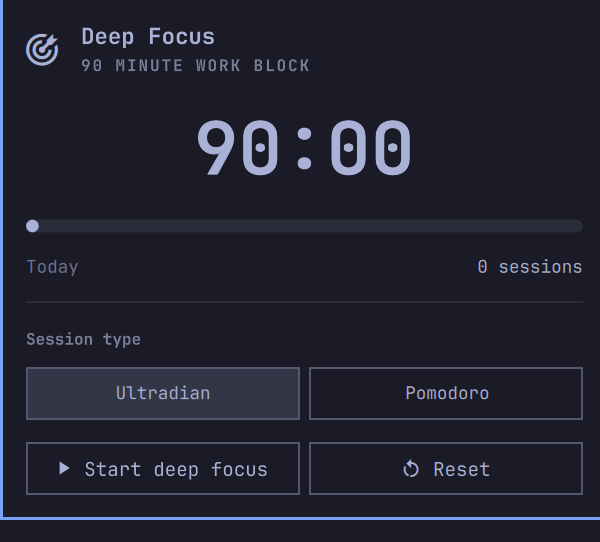

# Focus

A Pomodoro and ultradian focus timer for the [Omarchy](https://omarchy.org/) bar.



Two session types, each with its own recovery break:

- **Ultradian** — 90 minutes of deep focus, followed by a 20 minute break.
- **Pomodoro** — 25 minutes of short focus, followed by a 5 minute break.

The session buttons choose the method; the panel hero and action button use the focus type, so the context stays visible when the button changes from Start to Pause.

The timer lives in a shared Omarchy shell service, so every monitor shows the same countdown and a bar reload does not lose the session. A running session also survives a shell restart: the end time is stored on disk and the timer resumes from that wall-clock deadline.

## Features

- Icon-only bar widget: a dimmed target when idle or paused, a full target while focusing, and a stretching figure during breaks; hover it for the remaining time and state.
- Panel with session type, progress, start/pause, and reset.
- The session type is locked while a work block is running, so a stray click cannot change the current session.
- Session buttons show their configured lengths (`Deep Focus · 90 min`, `Short Focus · 25 min`), so both options stay comparable while queueing the next block. Their tooltips name the Ultradian and Pomodoro methods, summarize what each is best for, and append concrete examples; they appear on both hover and keyboard focus.
- While a session is active, the session-type header shows the upcoming sequence on its right: the break and next focus type during work, or just the next focus type during a break.
- Skip a break from the panel to start the next focus block early.
- Automatic breaks (configurable) and desktop notifications when a phase ends.
- Silences desktop notifications while a work block is active, then restores DND and replays Omarchy's notification history when the break begins.
- Leaves a Do Not Disturb setting you enabled yourself untouched.
- Notifications can open the panel, and start a ready break or focus block.
- Completed sessions counted for the day.
- Keyboard navigation in the panel: arrow keys or `j`/`k` move between rows, `h`/`l` move between buttons, `Enter`/`Space` activate, and `Escape` closes.
- Localized strings and theme-aware colors, borders, and spacing.

## Install

```bash
omarchy plugin add https://github.com/jimmerioles/omarchy-focus.git --enable
```

Omarchy will validate the manifest and enable the widget. If it lands somewhere other than you like, move it:

```bash
omarchy bar move jimmerioles.focus --section centerEnd --after omarchy.system-update
```

Plugins run as unsandboxed code inside the shell process. Only install plugins whose source you trust; this repository is small enough to read first.

Update the plugin later with:

```bash
omarchy plugin update jimmerioles.focus
```

## Usage

- **Left click** the bar widget: open the timer panel.
- **Right click**: start or pause.
- **Middle click**: reset the current session.

While a work block is running, the session type is locked. Pause the block or wait for the break to choose the next focus type. During a break, the buttons choose what comes next without changing the break; Reset applies a queued type immediately. The header’s right side shows the upcoming sequence while a session is active—for example, “Next: 20 min break → Ultradian” during Deep Focus, or “Next: Ultradian” during a break.

During a break the secondary button becomes **Skip break**; select it and press `Enter` or `Space` to return to a ready focus block.

The panel also exposes its controls over IPC:

```bash
omarchy-shell jimmerioles.focus status
omarchy-shell jimmerioles.focus start
omarchy-shell jimmerioles.focus pause
omarchy-shell jimmerioles.focus toggleTimer
omarchy-shell jimmerioles.focus reset
omarchy-shell jimmerioles.focus skipBreak
omarchy-shell jimmerioles.focus setMode deep
omarchy-shell jimmerioles.focus setMode pomodoro
omarchy-shell jimmerioles.focus startMode deep
omarchy-shell jimmerioles.focus startMode pomodoro
omarchy-shell jimmerioles.focus open
omarchy-shell jimmerioles.focus close
```

`status` returns JSON with the current mode, phase, remaining milliseconds, progress, and today's completed session count.

Notifications can be clicked to open the panel. When a break or work block is ready rather than auto-started, the notification also offers a button to start it.

While a work block is active, Focus enables Do Not Disturb. At the break it restores the previous DND state and uses Omarchy's existing notification history replay for review.

## Keybindings

Add one shortcut to open the panel:

```lua
-- Focus timer (replaces the stock Toggle full screen desktop binding)
o.rebind("SUPER + CTRL + ALT + F", "Focus timer", { panel = "jimmerioles.focus" })
```

This takes over `SUPER + CTRL + ALT + F` from **Toggle full screen desktop**. The panel uses the same shell toggle path as the first-party panels, so it opens on the focused monitor. Once open, everything is keyboard navigation:

- `↑` / `↓` or `j` / `k` move between the session-type row and the transport row.
- `←` / `→` or `h` / `l` move between the two buttons in the current row.
- `Enter` or `Space` activates the focused button.
- `Tab` / `Shift + Tab` switch to another bar panel.
- `Escape` closes the panel.

## Settings

Settings are stored on the widget's entry in `~/.config/omarchy/shell.json`:

```bash
omarchy bar set jimmerioles.focus deepMinutes 90
omarchy bar set jimmerioles.focus pomodoroMinutes 25
omarchy bar set jimmerioles.focus deepBreakMinutes 20
omarchy bar set jimmerioles.focus shortBreakMinutes 5
omarchy bar set jimmerioles.focus autoStartBreak true
omarchy bar set jimmerioles.focus autoStartWork false
omarchy bar set jimmerioles.focus notifications true
```

| Setting | Default | Meaning |
| --- | --- | --- |
| `deepMinutes` | `90` | Length of a deep focus block. |
| `pomodoroMinutes` | `25` | Length of a short focus block. |
| `deepBreakMinutes` | `20` | Break after deep focus. |
| `shortBreakMinutes` | `5` | Break after short focus. |
| `autoStartBreak` | `true` | Start the break when work ends. |
| `autoStartWork` | `false` | Start the next work block when a break ends. |
| `notifications` | `true` | Send a desktop notification when a phase ends. |

Changing a duration while a session is running does not alter that session; the new length applies to the next one.

## State

The timer state is kept in:

```text
~/.local/state/omarchy/focus/state.json
```

The directory is private to the user and the file is written atomically. A session that ends while the shell is down is completed silently, so the next phase is ready without a stale notification at login.

## Uninstall

```bash
omarchy plugin remove jimmerioles.focus
```

## Development

The plugin is a standard Omarchy shell plugin: `manifest.json` at the repository root, with a `bar-widget` entry point and a `service` entry point.

Validate a checkout before installing it:

```bash
omarchy plugin validate .
```

## License

MIT. See [LICENSE](LICENSE).
