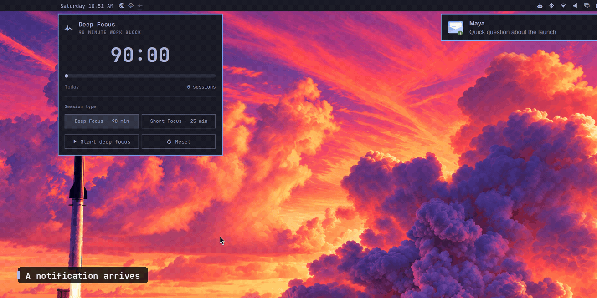

# Cadence

**Your workday, in rhythm.**

Cadence is a focused workday system for the [Omarchy](https://omarchy.org/) bar: focus deeply, protect your attention, plan your time, and decide what matters—without adding another place to manage.

[](https://github.com/jimmerioles/omarchy-cadence/actions/workflows/test.yml)
[](https://omarchy.org/)
[](LICENSE)



The demo shows the first wedge: **Focus + Attention**.

## Why Cadence

Most productivity tools add another place to manage. Cadence connects the workday you already have:

- **Focus without attention protection is just a countdown.** Notifications still win.
- **Attention protection without a plan is just silence.** You still don't know what to do.
- **Planning without decisions is a calendar full of the wrong things.**
- **Decisions without focus are intentions that never ship.**

Cadence connects them into one loop: **decide → plan → focus → rest**. Attention protects the focus block; the break is the rest.

## Four tools, one rhythm

| Pillar | What it does | Status |
| --- | --- | --- |
| **Focus** | Deep Focus (Ultradian 90/20) and Short Focus (Pomodoro 25/5) timers, automatic breaks. | Shipped |
| **Attention** | Do Not Disturb ownership and notification replay. Session goals, Focus Guard, notification digest, and parking lot next. | Shipped core |
| **Plan** | Timeboxing: shape the day into blocks, give each block an intention, and start a focus session from it. | Next major |
| **Decide** | An Eisenhower matrix: sort work by importance and urgency, then turn the right task into a timebox or focus block. | Later |

The tools are designed to share one local workday model. The bar is the glance; the panel is where you work. The full sequence is in the [roadmap](ROADMAP.md).

## Start with the first wedge

Cadence grows in complete, useful slices. The first is **Focus + Attention**—the part that delivers value on day one and earns the right to add planning and decisions.

Today, Cadence gives you:

- **Focus mode for your desktop.** Start a block and Cadence turns on Omarchy's Do Not Disturb—like Focus mode on your phone—and holds it through pauses. At the break, it restores the DND state it changed and replays recent notifications; DND you enabled yourself is left alone.
- **Two rhythms.** Deep Focus follows the Ultradian 90/20 rhythm; Short Focus follows Pomodoro 25/5. Both are configurable.
- **Breaks that happen.** Breaks can start automatically, and notifications mark each transition.
- **One timer everywhere.** A shared shell service keeps every monitor in sync, survives bar reloads, and resumes a running block after a shell restart.
- **Local only.** No accounts, telemetry, or network calls; timer state stays in a private local file.
- **Mouse or keyboard.** Left, right, and middle click on the bar; full keyboard navigation in the panel.

## Install

**Requirements:** Omarchy 4.5+ (Quattro), tested against 4.5.0, with its notifications service.

```bash
omarchy plugin add https://github.com/jimmerioles/omarchy-cadence.git --enable
```

Omarchy validates the manifest and enables the widget. When the install runs interactively, it asks where to place the widget; the default is the right edge of the center group (`centerEnd`). Move it later with:

```bash
omarchy bar move jimmerioles.cadence --section centerEnd
```

Update:

```bash
omarchy plugin update jimmerioles.cadence
```

Uninstall:

```bash
omarchy plugin remove jimmerioles.cadence
```

### Releases

Releases are tagged `vMAJOR.MINOR.PATCH`; [v1.0.0](https://github.com/jimmerioles/omarchy-cadence/releases/tag/v1.0.0) is the first tagged release: the Focus + Attention core. Tags mark stable snapshots for pinning or auditing, while the installer and `omarchy plugin update` track the default branch (`master`).

Plugins run as unsandboxed code inside the shell process. Only install plugins whose source you trust; this repository is small enough to read first.

## Use

### Bar

| Action | What it does |
| --- | --- |
| Left click | Open or close the Cadence panel. |
| Right click | Start or pause the current block. |
| Middle click | Reset the current block. |

The icon is a dimmed pulse when focus is idle or paused, a full pulse while focusing, and a stretching figure during a break (dimmed until the break starts). Hover for the phase, remaining time, and state.

### Panel

The panel shows the current phase, countdown, progress, and today's completed focus blocks. Start, pause, resume, reset, or skip a break from the transport row. Choose Deep Focus or Short Focus for the next work block; the buttons show the configured lengths.

- While a focus block is **running**, the session type is locked. A stray click cannot change the current block.
- While a focus block is **paused**, choosing a session type queues it; **Reset** applies it immediately.
- During a **break**, the buttons choose what comes next without changing the break. **Reset** restarts the break; **Skip break** returns to a ready focus block.

### Keyboard

Add this binding to `~/.config/hypr/bindings.lua`:

```lua
o.bind("SUPER + ALT + C", "Cadence", { panel = "jimmerioles.cadence" })
```

`SUPER + ALT + C` is free in stock Omarchy and opens the Cadence panel. If you want to start or pause the current block without opening the panel:

```lua
o.bind("SUPER + ALT + P", "Cadence start/pause", "omarchy-shell jimmerioles.cadence toggleTimer")
```

Hyprland reloads Lua bindings on save. To apply and validate manually:

```bash
hyprctl reload
hyprctl configerrors
```

Once the panel is open:

| Key | Action |
| --- | --- |
| `↑` / `↓` or `j` / `k` | Move between the session-type and transport rows. |
| `←` / `→` or `h` / `l` | Move between buttons in the current row. |
| `Enter` / `Space` | Activate the focused button. |
| `Tab` / `Shift + Tab` | Switch to another bar panel. |
| `Escape` | Close the panel. |

### Notifications and DND

While a focus block is active—including pauses—Cadence turns on Do Not Disturb if it was off. At the break it restores the DND state it changed and asks Omarchy to replay recent notifications. A DND you turned on yourself is left alone.

The replay is Omarchy's shell-wide history (the latest six cards), not a focus-only digest. A focus-session notification digest is planned for the next Attention release. Cadence completion notifications are sent after DND is restored and include their local send time.

The demo above shows the core loop: a notification arrives, focus starts with DND on, another notification stays quiet, and notifications return after focus.

See [Notifications and DND](docs/usage.md#notifications-and-dnd) for the full behavior.

## Configure

Defaults:

| Session type | Focus block | Break |
| --- | --- | --- |
| Deep Focus (Ultradian) | 90 minutes | 20 minutes |
| Short Focus (Pomodoro) | 25 minutes | 5 minutes |

Breaks start automatically; the next focus block waits for you. Completion notifications are on.

```bash
omarchy bar set jimmerioles.cadence deepMinutes 90
omarchy bar set jimmerioles.cadence shortMinutes 25
omarchy bar set jimmerioles.cadence autoStartBreak true
omarchy bar set jimmerioles.cadence notifications true
```

Settings live on the widget entry in `~/.config/omarchy/shell.json`. A running or paused block keeps its original length; a new length applies to the next phase. See the [settings reference](docs/reference.md#settings) for every key, range, and step.

## Command line

```bash
omarchy-shell jimmerioles.cadence status
omarchy-shell jimmerioles.cadence start
omarchy-shell jimmerioles.cadence startMode short
omarchy-shell jimmerioles.cadence skipBreak
```

`status` returns JSON with the selected and current mode, phase, run state, remaining time, progress, and today's completed focus blocks. See the [IPC reference](docs/reference.md#ipc) for all methods and the response schema.

## Troubleshooting

| Symptom | Check |
| --- | --- |
| The widget is missing | `omarchy plugin list`, then `omarchy plugin enable jimmerioles.cadence`. |
| The panel shortcut does nothing | The binding in `~/.config/hypr/bindings.lua`; run `hyprctl reload` and `hyprctl configerrors`. |
| The panel says “Cadence service is still loading” | Wait a moment after shell startup, or run `omarchy restart shell`. |
| Notifications are quiet | Check the `notifications` setting and whether Do Not Disturb is still on. |
| DND is still on after a block | Cadence only clears DND it enabled. Turn off DND manually if you enabled it yourself. |
| The timer needs a clean slate | `omarchy plugin disable jimmerioles.cadence`, delete `~/.local/state/omarchy/cadence/state.json`, then `omarchy plugin enable jimmerioles.cadence`. |

More in [Troubleshooting](docs/usage.md#troubleshooting).

## Roadmap

Cadence ships in wedges:

1. **Focus + Attention** (v1.0–1.1) — the shipped core; Focus Guard and the notification digest finish it.
2. **Plan** (v2.0) — timeboxing.
3. **Decide** (v3.0) — the Eisenhower matrix.

See [ROADMAP.md](ROADMAP.md) for the full sequence, scope boundaries, and what is deliberately not planned.

## Design principles

- **One workday model, four views.** Focus sessions, timeboxes, tasks, and decisions will share one local state.
- **Calm by default.** No badges, streaks, shame, or notification spam.
- **Local-first and private.** No accounts, telemetry, or network calls.
- **Keyboard-first, mouse-friendly.** Every control works without a mouse.
- **Integrate, don't replace.** Use Omarchy's DND, notifications, theme, and keybindings.
- **Ship one wedge completely.** A new pillar starts only when the previous wedge is excellent on its own.

## Development

The plugin is a standard Omarchy shell plugin: `manifest.json` at the repository root, a `bar-widget` entry point, and a `service` entry point. Timer rules live in `FocusModel.js` as pure functions; `Service.qml` owns QML state, timers, disk I/O, notifications, and other effects. Future pillars follow the same pattern: a pure model, a QML view, and a service that applies effects.

```bash
npm test
npm run validate
npm run lint:qml
npm run test:qml
```

`npm test` needs Node 20 or newer. The QML checks run on an Omarchy machine with `quickshell`, `jq`, and an Omarchy checkout at `OMARCHY_PATH` (defaults to `/usr/share/omarchy`); they do not need a compositor and never touch live timer state.

See [docs/architecture.md](docs/architecture.md) for the runtime design and [CONTRIBUTING.md](CONTRIBUTING.md) for setup, testing, and release steps.

## License

MIT. See [LICENSE](LICENSE).
