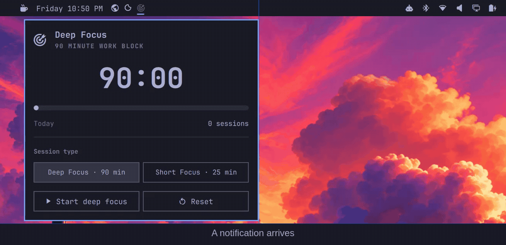

# Focus

A Deep Focus and Short Focus timer for the [Omarchy](https://omarchy.org/) bar—built to protect a work block, hand you back a real break, and stay out of the way.

[](https://github.com/jimmerioles/omarchy-focus/actions/workflows/test.yml)
[](https://omarchy.org/)
[](LICENSE)



## Why Focus

- **Two rhythms.** Deep Focus follows the Ultradian 90/20 rhythm; Short Focus follows Pomodoro 25/5. Both are configurable.
- **Breaks that happen.** Breaks can start automatically, notifications mark each transition, and focus notifications are quiet while you work.
- **One timer everywhere.** A shared shell service keeps every monitor in sync, survives bar reloads, and resumes a running block after a shell restart.
- **Local only.** No accounts, telemetry, or network calls; timer state stays in a private local file.
- **Mouse or keyboard.** Left, right, and middle click on the bar; full keyboard navigation in the panel.

## Install

**Requirements:** Omarchy 4.5+ (Quattro), tested against 4.5.0, with its notifications service.

```bash
omarchy plugin add https://github.com/jimmerioles/omarchy-focus.git --enable
```

Omarchy validates the manifest and enables the widget. When the install runs interactively, it asks where to place the widget; the default is the right edge of the center group (`centerEnd`). Move it later with:

```bash
omarchy bar move jimmerioles.focus --section centerEnd
```

Update:

```bash
omarchy plugin update jimmerioles.focus
```

Uninstall:

```bash
omarchy plugin remove jimmerioles.focus
```

Plugins run as unsandboxed code inside the shell process. Only install plugins whose source you trust; this repository is small enough to read first.

## Use

### Bar

| Action | What it does |
| --- | --- |
| Left click | Open or close the Focus panel. |
| Right click | Start or pause the current block. |
| Middle click | Reset the current block. |

The icon is a dimmed target when focus is idle or paused, a full target while focusing, and a stretching figure during a break (dimmed until the break starts). Hover for the phase, remaining time, and state.

### Panel

The panel shows the current phase, countdown, progress, and today's completed focus blocks. Start, pause, resume, reset, or skip a break from the transport row. Choose Deep Focus or Short Focus for the next work block; the buttons show the configured lengths.

- While a focus block is **running**, the session type is locked. A stray click cannot change the current block.
- While a focus block is **paused**, choosing a session type queues it; **Reset** applies it immediately.
- During a **break**, the buttons choose what comes next without changing the break. **Reset** restarts the break; **Skip break** returns to a ready focus block.

### Keyboard

Add this binding to `~/.config/hypr/bindings.lua`:

```lua
o.bind("SUPER + ALT + O", "Focus timer", { panel = "jimmerioles.focus" })
```

`SUPER + ALT + O` is free in stock Omarchy. If you prefer `SUPER + CTRL + ALT + F`, use `o.rebind`; it replaces the stock **Toggle full screen desktop** binding:

```lua
o.rebind("SUPER + CTRL + ALT + F", "Focus timer", { panel = "jimmerioles.focus" })
```

Hyprland reloads Lua bindings on save. To apply and validate manually:

```bash
hyprctl reload
hyprctl configerrors
```

Once the panel is open:

| Key | Action |
| --- | --- |
| `↑` / `↓` or `j` / `k` | Move between the session-type and transport rows. |
| `←` / `→` or `h` / `l` | Move between buttons in the current row. |
| `Enter` / `Space` | Activate the focused button. |
| `Tab` / `Shift + Tab` | Switch to another bar panel. |
| `Escape` | Close the panel. |

### Notifications and DND

While a focus block is active—including pauses—Focus turns on Do Not Disturb if it was off. At the break it restores the DND state it changed and asks Omarchy to replay recent notifications. A DND you turned on yourself is left alone.

The replay is Omarchy's shell-wide history (the latest six cards), not a focus-only digest. Focus completion notifications are sent after DND is restored and include their local send time.

See [Notifications and DND](docs/usage.md#notifications-and-dnd) for the full behavior.

## Configure

Defaults:

| Session type | Focus block | Break |
| --- | --- | --- |
| Deep Focus (Ultradian) | 90 minutes | 20 minutes |
| Short Focus (Pomodoro) | 25 minutes | 5 minutes |

Breaks start automatically; the next focus block waits for you. Completion notifications are on.

```bash
omarchy bar set jimmerioles.focus deepMinutes 90
omarchy bar set jimmerioles.focus shortMinutes 25
omarchy bar set jimmerioles.focus autoStartBreak true
omarchy bar set jimmerioles.focus notifications true
```

Settings live on the widget entry in `~/.config/omarchy/shell.json`. A running or paused block keeps its original length; a new length applies to the next phase. See the [settings reference](docs/reference.md#settings) for every key, range, and step.

## Command line

```bash
omarchy-shell jimmerioles.focus status
omarchy-shell jimmerioles.focus start
omarchy-shell jimmerioles.focus startMode short
omarchy-shell jimmerioles.focus skipBreak
```

`status` returns JSON with the selected and current mode, phase, run state, remaining time, progress, and today's completed focus blocks. See the [IPC reference](docs/reference.md#ipc) for all methods and the response schema.

## Troubleshooting

| Symptom | Check |
| --- | --- |
| The widget is missing | `omarchy plugin list`, then `omarchy plugin enable jimmerioles.focus`. |
| The panel shortcut does nothing | The binding in `~/.config/hypr/bindings.lua`; run `hyprctl reload` and `hyprctl configerrors`. |
| The panel says “Focus service is still loading” | Wait a moment after shell startup, or run `omarchy restart shell`. |
| Notifications are quiet | Check the `notifications` setting and whether Do Not Disturb is still on. |
| DND is still on after a block | Focus only clears DND it enabled. Turn off DND manually if you enabled it yourself. |
| The timer needs a clean slate | `omarchy plugin disable jimmerioles.focus`, delete `~/.local/state/omarchy/focus/state.json`, then `omarchy plugin enable jimmerioles.focus`. |

More in [Troubleshooting](docs/usage.md#troubleshooting).

## Roadmap

See [ROADMAP.md](ROADMAP.md) for what is shipped, what is next, and what is deliberately out of scope.

## Development

The plugin is a standard Omarchy shell plugin: `manifest.json` at the repository root, a `bar-widget` entry point, and a `service` entry point. Timer rules live in `FocusModel.js` as pure functions; `Service.qml` owns QML state, timers, disk I/O, notifications, and other effects.

```bash
npm test
npm run validate
npm run lint:qml
npm run test:qml
```

`npm test` needs Node 20 or newer. The QML checks run on an Omarchy machine with `quickshell`, `jq`, and an Omarchy checkout at `OMARCHY_PATH` (defaults to `/usr/share/omarchy`); they do not need a compositor and never touch live timer state.

See [docs/architecture.md](docs/architecture.md) for the runtime design and [CONTRIBUTING.md](CONTRIBUTING.md) for setup, testing, and release steps.

## License

MIT. See [LICENSE](LICENSE).
